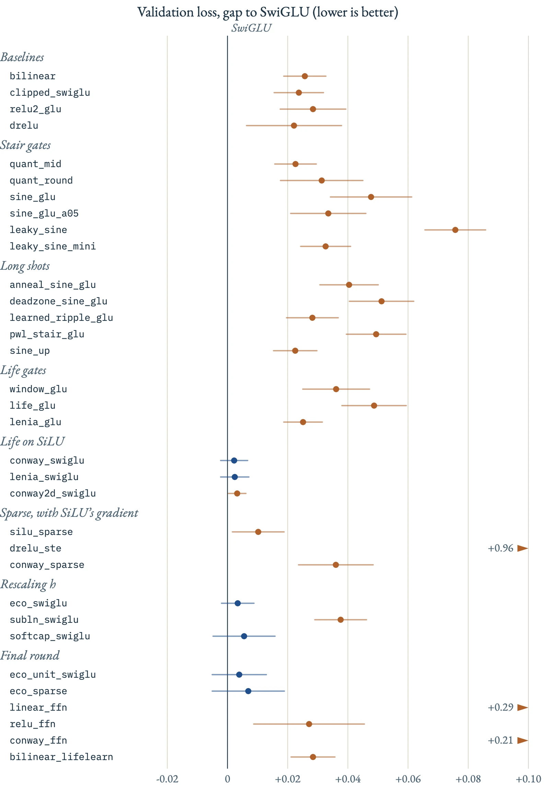
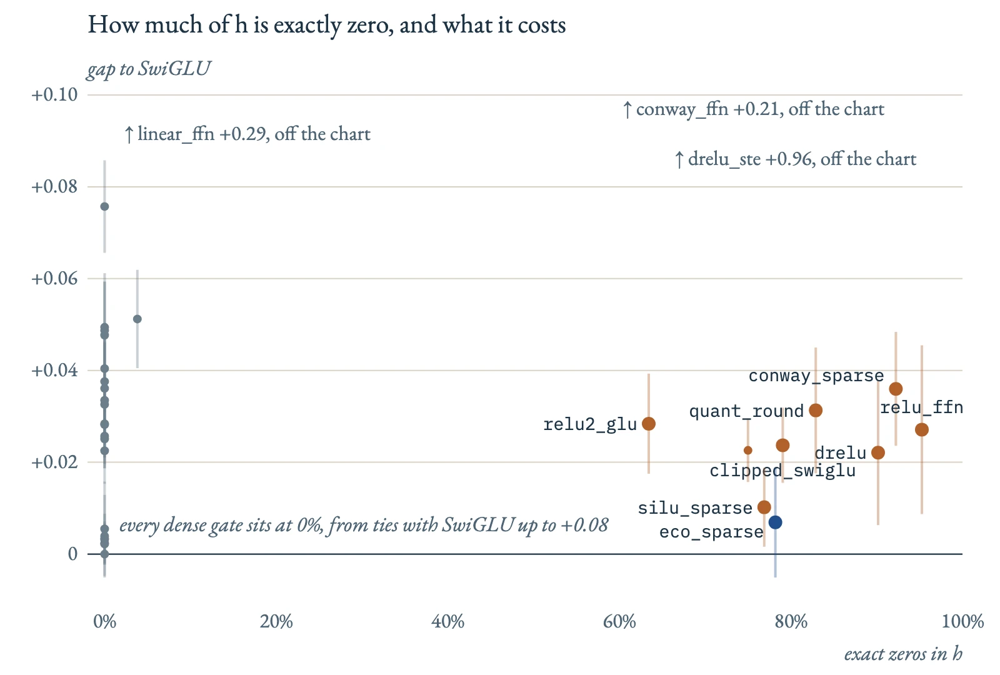

# Stairs and the Game of Life: 34 feed-forward gates against SwiGLU

**TLDR : I wanted an alternative to SwiGLU that ties with it and costs less compute, so I tried 34 gates in a transformer's feed-forward layer: staircases, sine ripples, Conway's Game of Life, sparse gates that keep SiLU's gradient, and energy budgets. 275 runs, six rounds in a week. Nothing beat SwiGLU, and every gate that tied it kept SiLU somewhere, in its forward pass or its backward pass. The best sparse gate makes 77% of the layer's output exactly zero for about +0.01 in loss.**

## The concept

The feed-forward layer computes two projections of each token, a and b, bends a with a gate, multiplies, and projects back:

> h = gate(a) · b,    out = W₃ h

The gate is the only nonlinear part. SwiGLU's gate is silu(a) = a · σ(a). Change the gate and you change what h looks like, and h is what you would quantize or skip in deployment:

*   If the gate only outputs a few levels, quantizing it should cost nothing.
*   If most of h is exactly zero, a sparse kernel can skip those units.

My aim was to find an alternative to SwiGLU that ties with it and costs less compute. Even if the compute cost went up, the learning should go up too, so it cancels out. But it should be something ReLU-like, something like Conway's Game of Life.

So I asked the same two questions of every gate: how close does it get to SwiGLU's loss, and what does it buy for quantization and sparsity?

## The Background

It started with a question about nonlinearities. I asked Claude:

> Can we try a ReLU staircase function? Like 0 to 1 gets 0.5, 1 to 2 gets 1.5.

That became `quant_mid`, the midpoint staircase. Then:

> What about smoothing the quantized one into smooth stairs, like a 45-degree small sine wave? But ReLU?

That became the sine staircase. I also asked what nonlinearity state-of-the-art models use, and the answer was SwiGLU. So the first experiment, on 29 October, was a short Colab run of SwiGLU, quantized SwiGLU and sine-quantized SwiGLU. Then:

> Sine on the negative side as well?

That's `sine_glu`, the two-sided ripple. And because I didn't want to test only ideas that were already out there:

> Make sure you do random stuff that you are 10% confident is promising, but not confident, because it's not in your data.

Those became the long shots: an annealed ripple, a ripple with a flat off state at zero, a ripple each unit learns, piecewise-linear stairs, and a ripple on the value branch.

Colab had two weaknesses: one learning rate for every gate, and too few seeds. So I moved the study to the AICR cluster, gave every gate its own learning-rate sweep and 5 paired seeds, and ran it in rounds, each one asking a question the last one raised.

## The setting

*   Model: a Llama-style GPT (RoPE, RMSNorm, tied embeddings) with 56.9M parameters: 10 layers, d_model 512, 8 heads, context 1,024, and 1,344 hidden units in each feed-forward layer.
*   Data: FineWeb-Edu (sample-10BT) in GPT-2 tokens. 9,000 steps of 64 × 1,024 tokens, about 590M tokens per run.
*   Training: AdamW (0.9, 0.95), weight decay 0.1, 300 warmup steps, cosine decay to 10%. bf16 on B200s, about 8 minutes a run.
*   Every gate gets a learning-rate sweep, then 5 seeds at its best rate. Seeds share their initialization and batches across gates, so every comparison is paired, and every ± below is a 95% interval over those 5 pairs.

## Round 1: stairs and ripples

16 gates in all: two hard staircases (`quant_mid`, my original design, and `quant_round`), four sine ripples on a, five long shots, and five baselines (SwiGLU, bilinear, clipped SwiGLU, relu² and dReLU).

Every one of the other 15 was worse than SwiGLU. The ripple did harm: `sine_glu`, which is bilinear plus a ripple, was worse than plain bilinear by 0.022 ± 0.009. The hard stairs landed next to clipped SwiGLU (`quant_mid` +0.023, clipped SwiGLU +0.024), so most of their cost was the clipping, not the stairs.

My guess at the time:

> I think it's because it loses the linear benefits that ReLU has, don't you think? It should be representing around ReLU.

That turned out to be the lesson of the whole study: every gate that tied SwiGLU kept silu somewhere.

12 of the 16 best learning rates sat at the edge of the grid, so I extended it in round 2. None of them moved; 10 gates collapsed at the new top rate.

## Rounds 2 and 3: Conway's Game of Life

Round 2 put each layer's units on a ring and let each unit's gate depend on its 8 nearest neighbours, the way a cell in Conway's Game of Life looks at the 8 cells around it. The smooth versions lost: `life_glu`, a soft B3/S23 rule, was +0.049, and `lenia_glu`, a learned window over the neighbours, only tied bilinear.

Round 3 used a neat way of writing the rule. The Game of Life doesn't need a 2-D nonlinearity at all: combine a cell's own state s and its count of live neighbours n into one number, z = 2n + s. A dead cell with 3 neighbours gives z = 6 (birth), a live cell with 2 or 3 gives 5 or 7 (survival), and every other case lands at 4 or below, or at 8 or above. So a cell lives next step exactly when z is between 5 and 7, and that window is four ReLUs:

> f(z) = ReLU(z − 4) − ReLU(z − 5) − ReLU(z − 7) + ReLU(z − 8)

That's one linear step, a 3 × 3 kernel with 2s around the edge and a 1 in the centre, followed by a 1-D ReLU window. A ReLU-like nonlinearity that runs the Game of Life was exactly the kind of thing I was looking for.

Round 3 kept the rule exact like this and used it only to scale silu(a), starting as plain SwiGLU. All three versions, on a ring, with learned window edges, and on a 2-D torus like Conway's board, came within 0.003 of SwiGLU. Training kept the rule switched on, positive on every seed, damping the units it says should die by about a fifth, for no gain in loss. And INT4 cost them 1.8 to 4.1 times what it costs SwiGLU.

## Round 4: sparse, with SiLU's gradient

Two things from the earlier rounds pointed here. Clipped SwiGLU ties SwiGLU at a matched learning rate but can't use high ones, while `quant_mid`'s straight-through backward pass barely degrades at a high rate. So `silu_sparse` keeps the clipped forward pass, max(silu(a), 0), with its exact zeros, and trains on silu's gradient, so units below zero keep learning instead of going dead.

It worked: 77% of h exactly zero, for +0.010 ± 0.009, and 0.014 better than clipped SwiGLU. Its mirror image failed hard: `drelu_ste`, dReLU forward with silu's gradient backward, stalled near a loss of 4.5 on every seed, because the gradient it trains on no longer matches the function it runs. Pruning weak units with Conway's rule (`conway_sparse`) reached 92% zeros at +0.036.

## Round 5: rescaling h

Round 5 changed h itself, after the gate. `eco_swiglu` gives each token an energy budget, h / √(1 + E/K): when the token's total activity E grows past K, every unit is scaled down by the same factor. It ties SwiGLU (+0.003 ± 0.005) and survives a learning rate of 8e-3, where SwiGLU collapses. RMSNorm on h (`subln_swiglu`), the hard version of the same idea, is the one SiLU gate in the study that loses, by 0.038. A soft cap on h (`softcap_swiglu`) ties, but the cap reached only about 1% of values, so that test was mild. And at a matched learning rate of 2e-3, `silu_sparse` ties SwiGLU too.

## Round 6: the last bets

The last round started from one question:

> What if we totally remove the nonlinearity and bring life into the picture in order to learn?

So I tried both halves of it, a layer whose only nonlinearity is Conway's rule and a plain bilinear layer where the rule only shapes the gradients, alongside two refinements of round 5.

*   `eco_unit_swiglu` gives every unit its own gain: it ties SwiGLU, and ties the one-number budget.
*   `eco_sparse` puts the budget on `silu_sparse`: 78% exact zeros at +0.007 ± 0.012, the original goal of the study, though the interval is too wide to call it as good.
*   With no gate and no nonlinearity at all, the feed-forward layer is the floor, 0.29 behind SwiGLU. A ReLU recovers 0.27 of that, and Conway's rule as the only nonlinearity (`conway_ffn`) recovers 0.08.
*   `bilinear_lifelearn` lets Conway's rule shape only the gradients. It ends 0.003 ± 0.002 behind plain bilinear.

## The follow-up

On 5 November I ran `silu_sparse` against SwiGLU again, at two sizes. At 57M over 15 seeds it is equivalent to SwiGLU within ±0.01 (+0.0066). At 125M parameters on 2.5B tokens the gap was +0.0105, which the test counted as a real difference. A lower learning rate also cut SwiGLU's per-token INT4 penalty, on 10 of 10 seeds.

## Weird properties that emerge

1.  Every gate that ties SwiGLU keeps silu(a) in its forward pass or its backward pass. Smooth beats hard, and hard beats rough.
2.  `learned_ripple_glu`'s ripple shrank from 0.5 to about 0.26 during training, but never to zero.
3.  Training kept the Conway modulation on every seed, damping units by about 20%, for no gain.
4.  Every collapse looks the same: a loss of about 5.75 by step 1,000, a jump to about 7.5 between steps 2,000 and 4,000, and no recovery.
5.  Gates at lower learning rates lead until about step 7,000, then fall behind.
6.  The bounded gates survive 8e-3 where SwiGLU collapses, yet still train best at 2e-3. At 1.6e-2, the energy budget K blew up to 2.4 × 10⁵.
7.  The sparse kernel is slower than dense on a B200 at batch 1 (0.51–0.81×), but faster on CPU: 1.5–2.3× with 10–23% of units active.
8.  Training never arranged the units by their place on the ring. `life_glu`'s clustering is mostly built in by the neighbours units share.

## Traps I fell into

The learning rate confounded the gate comparisons twice. In round 1 most best rates sat at the edge of the grid, and in round 4 part of `silu_sparse`'s gap was the learning-rate ceiling: at a matched rate it ties.

The INT4 numbers misled me. Per-token INT4 made the new gates look much better than SwiGLU, but that was mostly their lower learning rate: SwiGLU trained at 2e-3 loses +0.27 under INT4, against +0.77 at 4e-3. Quantized per group of 64, the way deployments do it, every gate lands at +0.02–0.03.

My first theory for why the Life gates break under INT4 was wrong. I thought flips in the rule cascaded through the layers, but freezing the rule removed only −10% to +9% of the penalty, and injecting noise ruled out amplification. A probe of the values INT4 rounds to exactly zero found the mechanism: that dead zone compounds 3–11× across the layers of a Life network, against 2.5× for SwiGLU.

Testing every new gate on CPU before launching caught bugs that would have cost runs: new gates missing a code path (which would also have crashed round 5's tasks still running), a resume bug that changed the logged loss at one step, and a pruning ramp that ended at 8% of training instead of 10%.

With 35 pre-registered checks, about 2 "significant" results are expected by chance, so `bilinear_lifelearn`'s small gap is a lead, not a finding.

## Questions I am trying to answer

1.  Why do the Life networks compound INT4's dead zone more than SwiGLU does? A per-unit-mean replacement would be the stronger test.
2.  The Life gates also lose the most when their gate is rounded to a coarse grid. Is that linked to the rule damping silu(a)? That's untested.
3.  Does bounding h without rescaling it hurt, as Qiu et al. predict? `softcap_swiglu` only touched about 1% of values.
4.  Does `silu_sparse`'s gap stay this small at larger scale? It was +0.0066 at 57M and +0.0105 at 125M.
5.  How far does any of this go? It's one model, one dataset and one token budget.

## Try it yourself

GLU Gate Lab : [all 34 gates, up close](/lab/glu-gates/). Pick a gate to see its curve and the slope training sees, watch a live layer of 64 hidden units, and see the Game of Life rule at work on a ring of units or an 8 × 8 board.

## References

*   [Shazeer (2020), GLU Variants Improve Transformer](https://arxiv.org/abs/2002.05202)
*   [Shleifer et al. (2021), NormFormer: Improved Transformer Pretraining with Extra Normalization](https://arxiv.org/abs/2110.09456)
*   [Wang et al. (2024), BitNet a4.8: 4-bit Activations for 1-bit LLMs](https://arxiv.org/abs/2411.04965)
*   [Song et al. (2024), Turbo Sparse: Achieving LLM SOTA Performance with Minimal Activated Parameters](https://arxiv.org/abs/2406.05955)
*   [Horuz et al. (2025), The Resurrection of the ReLU](https://arxiv.org/abs/2505.22074)
*   [Lomeli et al. (2025), Stochastic activations](https://arxiv.org/abs/2509.22358)
*   [Qiu et al. (2026), A Unified View of Attention and Residual Sinks: Outlier-Driven Rescaling is Essential for Transformer Training](https://arxiv.org/abs/2601.22966)
*   [Chan (2018), Lenia: Biology of Artificial Life](https://arxiv.org/abs/1812.05433)
